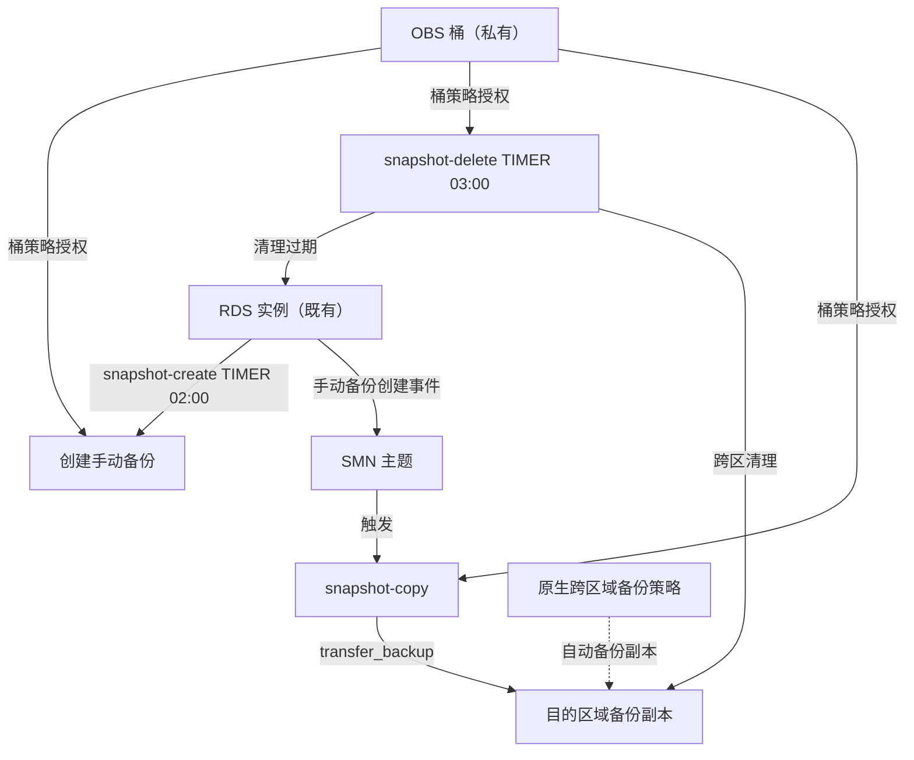

# deterministic-operations-cross-region-db-backup · 云数据库 跨区域备份容灾自动化（华为云）


基于华为云原生服务的 **云数据库 手动备份创建 + 跨区域传输 + 过期清理** 自动化方案，实现「备份-恢复型」
跨区域容灾（Cross-Region DR）。适用于需要对关键 云数据库 实例做跨区域冗余备份、并按保留期自动清理过期
备份的场景。本方案**不创建 云数据库 实例**，只管理既有实例的备份。

## 1. 简介 / Overview

### 简介


基于华为云原生服务的 **云数据库 手动备份创建 + 跨区域传输 + 过期清理** 自动化方案，实现「备份-恢复型」
跨区域容灾（Cross-Region DR）。适用于需要对关键 云数据库 实例做跨区域冗余备份、并按保留期自动清理过期
备份的场景。本方案**不创建 云数据库 实例**，只管理既有实例的备份。

---

## 2. 目录


- [1. 简介 / Overview](#1-简介--overview)
- [2. 目录](#2-目录)
- [3. 架构图](#3-架构图)
- [4. 方案亮点](#4-方案亮点)
- [5. 涉及云服务](#5-涉及云服务)
- [6. 前置条件](#6-前置条件)
- [7. 快速开始](#7-快速开始)
- [8. 分步部署](#8-分步部署)
- [9. 使用方法 / 验证](#9-使用方法--验证)
- [10. 清理资源](#10-清理资源)
- [11. 详细说明](#11-详细说明)
- [12. 依赖](#12-依赖)
- [13. FAQ / 故障排除](#13-faq--故障排除)
- [14. 贡献指南](#14-贡献指南)
- [15. 许可证](#15-许可证)
- [16. 联系方式 / 维护者](#16-联系方式--维护者)


---

## 3. 架构图



详见 [docs/architecture.md](docs/architecture.md)。

---

## 4. 方案亮点

- **Serverless 自动化**：三个 FunctionGraph 函数分别完成「创建 / 跨区域传输 / 清理」，按需触发。
- **双通道跨区域 DR**：手动备份经 `transfer_backup` 跨区域传输 + 自动备份经原生跨区域策略兜底，覆盖完整。
- **零凭据落盘**：函数运行期凭证由 FunctionGraph 委托经 `context` 注入，代码与文档不含任何真实 AK/SK。
- **最小暴露面**：函数部署包存于**私有** OBS 桶，仅经桶策略授权委托读取，无公网暴露。
- **一键 IaC**：Terraform + huaweicloud Provider 统一定义全部资源，`terraform validate` 已通过。

---

## 5. 涉及云服务

本实践使用以下华为云服务（资源清单见 `docs/deployment-guide.md`）：

| 服务 | 用途 |
|---|---|
| RDS（云数据库） | 源/目的区域数据库实例与备份 |
| FunctionGraph（FGS） | 三个编排函数（创建/传输/清理） |
| SMN（消息通知） | RDS 事件订阅触发复制函数 |
| OBS（对象存储） | 函数部署包私有桶 |
| IAM（Agency） | FunctionGraph 委托 |

---

---

## 6. 前置条件

- 已完成华为云实名认证，账户余额充足。
- 本地安装 **Terraform ≥ 1.5**（`terraform version` 验证）。
- 创建 AK/SK 并通过环境变量提供（**勿写入代码/配置**）：
```bash
export HW_ACCESS_KEY="<HW_ACCESS_KEY>"
export HW_SECRET_KEY="<HW_SECRET_KEY>"
# 临时凭证（推荐）：export HW_SECURITY_TOKEN="<TOKEN>"
```
- 源/目的区域均已开通 云数据库；目的区域已在控制台开通「备份跨区域传输」授权。
- 源区域已存在需纳入 DR 的**既有 云数据库 实例**（本方案不创建实例）。

---

## 7. 快速开始

```bash
# 1. 打包函数（自带 huaweicloud SDK 依赖）
cd src && python build_functions.py && cd ..

# 2. 部署基础设施
cd infra
terraform init
terraform validate
terraform plan
terraform apply
```

完整步骤与清理见 [docs/deployment-guide.md](docs/deployment-guide.md)。

---

## 8. 分步部署

1. **打包函数**：`cd src && python build_functions.py`，生成 `snapshot_*/snapshot_*.zip`。
2. **配置变量**：编辑 `infra/terraform.tfvars`（见部署指导书第 2 节），填入 `instance_ids`
`secondary_region`、`secondary_project_id` 等。
3. **初始化与校验**：`terraform init` → `terraform validate` → `terraform plan`。
4. **部署**：`terraform apply`。
5. **手动步骤**：源实例区域控制台创建「云数据库 事件订阅」指向输出的 `smn_topic_urn`（Terraform 无该资源）。

---

## 9. 使用方法 / 验证

### 使用方法与验证


部署成功后：

1. FunctionGraph 控制台确认 3 个函数已启用，触发器为 2×TIMER（ACTIVE）+ 1×SMN（ACTIVE）。
2. 手动或等待定时触发 `snapshot-create`，在 云数据库 控制台确认出现 `rds-dr-automation-<实例>-<ts>`
且状态 `COMPLETED`。
3. 配置 云数据库 事件订阅后，新建手动备份应自动经 SMN 触发 `snapshot-copy` 跨区域传输至目的区域。
4. 确认 SMN 邮件订阅已点击确认链接。

详细验证与已知坑见 [docs/deployment-guide.md](docs/deployment-guide.md) 第 7、10 节。

---

## 10. 清理资源

```bash
cd infra && terraform destroy
```

> `destroy` 前请确认已无需要保留的手动/跨区域备份；OBS 桶设了 `force_destroy=true` 会一并删除。
> 版本化 OBS 桶若 `destroy` 报 `MalformedXML`，需先清空所有 version + delete marker 再删桶。

---

## 11. 详细说明

- **三大动作**：创建（TIMER 每日 02:00 UTC）/ 跨区域传输（SMN 触发）/ 清理（TIMER 每日 03:00 UTC）。
- **标记策略**：手动备份创建接口不支持 tags，改用**名称前缀** `SNAPSHOT_PROCESS_NAME-` 标识归属
清理时按前缀 + 创建时间过滤，避免误删其它备份（详见 [docs/architecture.md](docs/architecture.md) §5）。
- **跨区域能力边界**：华为云 `复制备份` 仅同区域，手动快照跨区域用 `transfer_backup`，自动备份跨区域
用原生跨区域备份策略，二者互补。
- **权限委托**：`op_svc_cff` 委托，`OBS Administrator`（AX）+ 云数据库/SMN FullAccess（XA，源/目的两区域）。
- **触发器稳定性**：三个触发器均 `ignore_changes=[event_data,status]`，规避 ACTIVE 下 PUT 被拒。

配置项说明见 `infra/variables.tf`；约束满足情况。

---

## 12. 依赖

- **运行时依赖**：`huaweicloudsdkrds` / `huaweicloudsdkcore`（已打包进函数 zip）。
- **IaC**：Terraform + `huaweicloud` Provider。
- 架构模式参考华为云官方 云数据库 / FunctionGraph / SMN 最佳实践。

---

## 13. FAQ / 故障排除

### FAQ


- **函数报缺 SDK 包**：检查 zip 是否含 `huaweicloudsdkrds` 目录；本方案已自带依赖。
- **跨区域传输报未授权**：源区域须在控制台开通「备份跨区域传输」并授权目的区域。
- **SMN 收不到邮件**：订阅后需点击确认邮件完成订阅。
- **改代码后函数不重拉包**：`terraform apply -replace=huaweicloud_fgs_function.<name>` 强制重建。
- **改 agency 权限后调用仍 403**：热实例缓存旧凭证，请控制台「清理实例」或重建函数冷启动。

---

## 14. 贡献指南

欢迎提交 Issue 反馈问题或改进建议。请通过项目 Issue 渠道提交反馈。

---

## 15. 许可证

本实践采用 **MIT No Attribution** 许可证，详见仓库根目录 [`LICENSE`](LICENSE) 文件。


本项目以 **Apache-2.0** 许可证开源。详见 [LICENSE](LICENSE)（若未单独提供，以本声明为准）。

---

## 16. 联系方式 / 维护者
| 项 | 内容 |
|---|---|
| **创建者** | [dgc-git](https://github.com/dgc-git) |
| **维护者** | [dgc-git](https://github.com/dgc-git) |
| **联系方式** | GitHub Issues / PR（见[第 14 节](#14-贡献指南)） |
