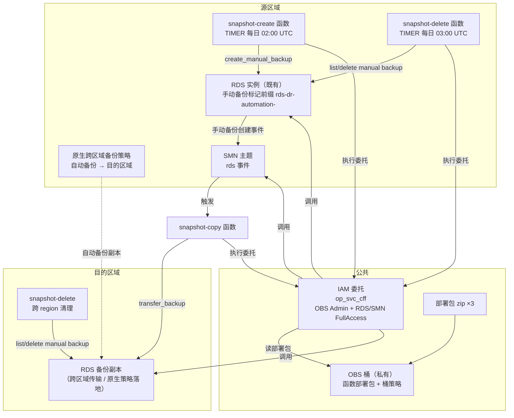

# 云数据库 跨区域备份容灾自动化（华为云）

本实践基于华为云原生服务，构建一套**云数据库 手动备份创建 + 跨区域传输 + 过期清理**的自动化体系
实现「备份-恢复型」跨区域容灾（Cross-Region DR）。适用于需要对关键 云数据库 实例做跨区域冗余备份
并按保留期自动清理过期备份的场景。

> 本实践**不创建 云数据库 实例**，只管理既有实例的备份（与绝大多数 云数据库 备份自动化场景一致：实例生命周期由业务侧独立管理）。

## 1. 架构总览



## 2. 核心组件

| 组件 | 华为云服务 | 职责 |
|------|------------|------|
| 备份目标 | 云数据库 云数据库 | 承载业务数据的既有实例；本实践只管理其备份，不创建实例 |
| 备份创建 | 函数工作流 FunctionGraph（`snapshot-create`） | 定时为每个目标实例创建带统一前缀标记的手动备份，带重试 |
| 跨区域传输 | FunctionGraph（`snapshot-copy`） | 由 云数据库 事件经 SMN 触发，将刚创建的手动备份跨区域传输到目的区域 |
| 过期清理 | FunctionGraph（`snapshot-delete`） | 定时清理源/目的两区域中超过保留期、且由本自动化创建的手动备份 |
| 事件通知 | 消息通知服务 SMN | 承接 云数据库「手动备份创建成功」事件，触发 copy 函数；预留邮件告警订阅 |
| 原生跨区策略 | 云数据库 跨区域备份策略 | 将实例**自动备份**自动复制到目的区域，作为底层 DR 兜底 |
| 部署包存储 | 对象存储 OBS | 私有存放三个函数部署包；经桶策略授权 FunctionGraph 委托读取 |
| 权限委托 | IAM 委托 Agency | 函数以委托身份调用 云数据库 / SMN / 读取 OBS，无需硬编码凭证 |

## 3. 三大自动化动作

| 动作 | 触发方式 | 对应华为云 API | 说明 |
|------|----------|----------------|------|
| 创建手动备份 | TIMER 定时（默认每日 02:00 UTC） | `CreateManualBackup` | 备份名带 `SNAPSHOT_PROCESS_NAME-` 前缀作为「本自动化管理」标记 |
| 跨区域传输 | SMN 触发（云数据库 手动备份创建事件） | `TransferBackup` | 把刚创建的手动备份复制到目的区域 |
| 过期清理 | TIMER 定时（默认每日 03:00 UTC） | `ListBackups` + `DeleteManualBackup` | 按名称前缀 + 创建时间过滤，源/目的两区域分别清理 |

> 触发器的 `event_data` / `status` 字段已加 `ignore_changes`，避免 ACTIVE 状态下
> Terraform 反复 PUT 被 API 拒绝（详见部署指导书「已知坑」）。

## 4. 数据流转

1. **创建**：`snapshot-create` 每日定时为每个目标实例调用 `create_manual_backup`，备份名形如
`rds-dr-automation-<实例ID>-<UTC时间戳>`，以此前缀标识为本自动化管理。
2. **事件**：云数据库 手动备份创建成功后发出事件，经控制台创建的「云数据库 事件订阅」投递到 SMN 主题。
3. **传输**：SMN 消息触发 `snapshot-copy`，解析出实例/备份 ID（解析失败则回退到「最新带前缀且
COMPLETED 的手动备份」），调用 `transfer_backup` 跨区域传输到目的区域。
4. **兜底**：原生 `rds_cross_region_backup_strategy` 将实例**自动备份**持续复制到目的区域
与手动备份传输互为补充。
5. **清理**：`snapshot-delete` 每日定时，在源区域与目的区域分别列出带前缀、状态 `COMPLETED`
且创建时间早于保留期（`snapshot_retention_in_days`）的手动备份并删除，防止备份无限堆积。

## 5. 标记策略（为何用「名称前缀」而非标签）

云数据库 手动备份的创建接口（`CreateManualBackup`）**不支持 tags 字段**，无法像资源那样用标签标记归属。
本实践改用**备份名称前缀**（`SNAPSHOT_PROCESS_NAME-`）作为「本自动化创建」的标识：创建时写入前缀
清理时按前缀过滤，二者闭环一致，避免误删用户手动创建的其它备份。

## 6. 目录结构

```
huaweicloud/deterministic-operations-cross-region-db-backup/
├── docs/ # 本实践文档（架构 / 部署 / 质量门禁）
├── infra/ # Terraform IaC（huaweicloud Provider）
├── src/ # FunctionGraph 函数代码与依赖打包脚本
└── README.md
```
